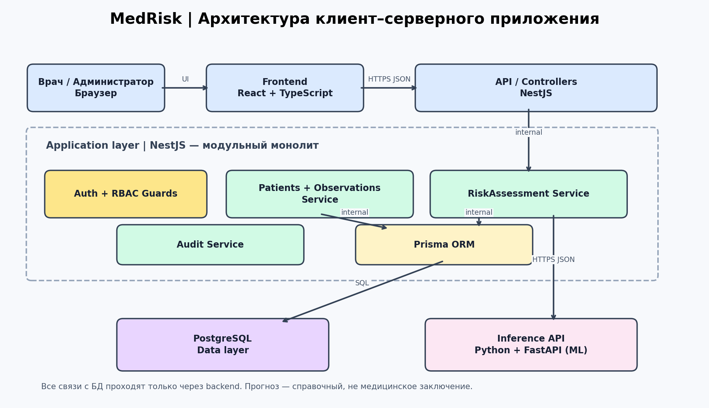

# MedRisk — архитектура клиент-серверного приложения

## Описание системы
MedRisk — учебная веб-система поддержки врачебных решений для оценки риска осложнений и повторной госпитализации. Врач создаёт карточку пациента и вносит клинические показатели, после чего запрашивает предварительную оценку риска. Система сохраняет историю оценок, чтобы врач мог сравнивать результаты во времени. Администратор управляет учётными записями сотрудников и назначает роли, но не получает доступ к клиническим данным без отдельного разрешения. Врач видит только пациентов, к которым у него есть назначенный доступ. По сравнению с разрозненными таблицами система обеспечивает единые правила ввода, аудит действий и централизованное хранение. Оценка носит справочный характер и не заменяет медицинское заключение; для реального применения нужны клиническая валидация и соблюдение законодательства о персональных данных.

## Команда
Артылбекова Медина Туратбековна — учебный проект.

## Предметная область
**Роли:** врач, администратор. Администратор не имеет автоматического права читать клинические данные.

**Сущности (8):** Пользователь (User), Роль (Role), Пациент (Patient), Назначение доступа (CareAssignment), Клиническое измерение (Observation), Оценка риска (RiskAssessment), Версия модели (ModelVersion), Журнал аудита (AuditEvent).

**Операции (12):**
1. Вход и выход из системы
2. Создание карточки пациента
3. Поиск доступных пациентов
4. Изменение карточки
5. Добавление показателя
6. Исправление показателя с записью аудита
7. Запуск оценки риска
8. Просмотр истории оценок
9. Создание учётной записи врача
10. Изменение роли
11. Блокировка пользователя
12. Просмотр событий аудита уполномоченным администратором

## Роли и сценарии
| ID | Роль | Сценарий | Результат |
|---|---|---|---|
| UC1 | Врач | Создаёт карточку пациента | Карточка сохранена |
| UC2 | Врач | Вносит и исправляет показатели пациента | Показатели сохранены с датой |
| UC3 | Врач | Запрашивает оценку риска | Показана оценка и версия модели |
| UC4 | Врач | Просматривает историю оценок | Список предыдущих расчётов |
| UC5 | Администратор | Создаёт учётную запись врача и назначает роль | Учётная запись активна |
| UC6 | Администратор | Блокирует учётную запись сотрудника | Доступ отозван |

## Архитектура

Описание компонентов: [docs/components.md](docs/components.md).

Жизненный цикл запроса: [docs/request-lifecycle.md](docs/request-lifecycle.md).

## Обоснование решений
### Почему три уровня?
React не имеет доступа к PostgreSQL: NestJS проверяет права и входные данные. Прямой доступ из браузера раскрыл бы учётные данные БД и обошёл серверные проверки.

### Где хранятся данные?
Пациенты, показатели, назначения, оценки и аудит — только в PostgreSQL; браузер держит минимум временного состояния. Токен передаётся по HTTPS, предпочтительно в защищённой HttpOnly-cookie; медицинские данные не кладём в localStorage.

### Как работает stateless?
Каждый запрос проходит проверку токена и прав; сервер не полагается на память предыдущего запроса. При нескольких экземплярах NestJS любой экземпляр может обработать запрос.

### Почему модульный монолит?
Для учебного проекта одна развёртываемая NestJS-система проще тестируется и сопровождается, а модули отделяют функции. Python Inference API выделен из-за отдельного ML-стека; при росте нагрузки можно масштабировать его независимо.

### Почему серверная проверка?
Frontend помогает с формами, но его можно обойти. Backend повторно проверяет типы, диапазоны показателей, полномочия врача и принадлежность пациента; иначе возможны утечки и неверные оценки.

## Риски
| Риск | Последствие | Снижение риска |
|---|---|---|
| Несанкционированный доступ к карте пациента | Утечка чувствительных медицинских сведений | RBAC + проверка назначений на уровне записи, HTTPS, аудит, минимальные права |
| Недоступна модель или ошибочный прогноз | Врач не получит расчёт либо увидит вводящий в заблуждение результат | 503 без фиктивного результата; версия модели, клиническая валидация, мониторинг качества, предупреждение |
| Потеря или повреждение БД | Утрата истории и показателей | Резервные копии, проверка восстановления, транзакции, шифрование |
| Подбор пароля или кража токена | Компрометация учётной записи | MFA для реального развёртывания, rate limiting, короткие сессии, отзыв доступа |
| Некорректные или устаревшие показатели | Искажённая оценка риска | Валидация диапазонов и даты, явное указание недостающих данных, подтверждение врача |

## Ограничения
Проектирование, а не действующий медицинский сервис. Все примеры пациентов и домены условные; реальные медицинские данные не используются. ML-модель и API только запроектированы. До реального внедрения нужны правовая и клиническая экспертиза.

## Сдача
Откройте папку в Git, сделайте не менее 4 осмысленных коммитов и опубликуйте репозиторий на GitHub самостоятельно.
